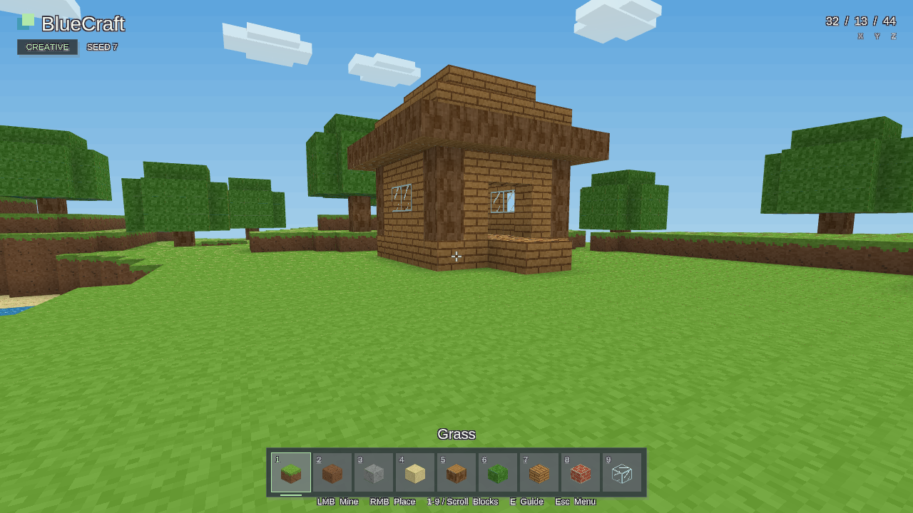

# BlueCraft

Build a little world.

[Download the Windows x64 installer](https://github.com/kevstermcgee/BlueCraft/releases/latest) · [Game guide and screenshots](https://kevstermcgee.github.io/BlueEngineGames/games/bluecraft/)

BlueCraft is a small Minecraft-style creative voxel sandbox made with
[BlueEngine](https://github.com/kevstermcgee/BlueEngine). Explore a first-person
block landscape with a starter cottage, trees and a pond, then mine and build
with nine unlimited materials. The finite world measures 64 × 64 × 32 blocks.
There are no enemies, survival meters or required objectives: choose your own
building project.



Download the installer EXE from the latest release, run it, and launch BlueCraft
from its installed shortcut. The release also includes checksums and verification
metadata. Linux is supported for development; the public release is for Windows x64.

## Controls

| Control | Action |
| --- | --- |
| WASD | Move |
| Mouse | Look |
| Space | Jump |
| Shift | Sprint |
| Left click | Break targeted block |
| Right click | Place selected block |
| Mouse wheel / 1–9 | Select material |
| Middle click | Pick targeted material |
| F5 / F9 | Save / load a manual checkpoint |
| E | Show help |
| Esc | Pause / resume |
| F | Toggle fullscreen |

The palette order is grass, dirt, stone, sand, oak log, leaves, oak planks, brick
and glass. Aim within six metres to edit a block. Bedrock cannot be broken, and
blocks cannot be placed outside the world or inside the player.

Normal play automatically resumes your previous world. Progress saves every
15 seconds and on a clean exit. F5 and F9 use a separate manual checkpoint,
so automatic saves preserve that checkpoint. Loading the checkpoint restores
its world and player position, replacing subsequent changes.

Start with `--fresh` for a new world or `--seed N` for a repeatable world. These
runs leave automatic progress untouched and do not save automatically; F5 can
still write a manual checkpoint.

## Develop

Install Rust, Python 3 and your platform's native build dependencies. Clone
BlueEngine into the sibling directory required by this project's Cargo path
dependency, and check out the pinned engine revision:

```sh
git clone https://github.com/kevstermcgee/BlueEngine.git bluecraft-engine
git -C bluecraft-engine checkout e7ba8467fe9043527579fc8fac3de7818dddea3a
git clone https://github.com/kevstermcgee/BlueCraft.git bluecraft
cd bluecraft
cargo test --locked --no-default-features
scripts/blue dev
```

On Windows, use the MSVC Rust toolchain and Windows SDK, and run
`python scripts/dev.py` or `scripts/blue.ps1 dev` in place of the shell runner.

```sh
scripts/blue dev -- --fresh
scripts/blue dev -- --seed 42
scripts/blue dev -- --capture .blue-check/captures --frames 30,120 --exit-after 130
```

## Windows release workflow

The [Windows release workflow](.github/workflows/release.yml) checks formatting,
game tests, Clippy and content; builds the native package with MSVC; verifies
Windows executable resources; and launches the packaged game in isolation using
software OpenGL. It then builds the Inno Setup installer and exercises installation,
upgrade and uninstall. The workflow compares the tested installer hash before
publishing that exact EXE, its SHA-256 checksum and release metadata.

For local Windows packaging with Inno Setup 6 installed:

```text
python scripts/ship.py ship --no-install
python scripts/ship.py installer prepare
python scripts/ship.py installer build --iscc "C:\Program Files (x86)\Inno Setup 6\ISCC.exe"
python scripts/ship.py installer test --stage "ABSOLUTE PREPARED STAGE PATH"
```

Run installer lifecycle tests on an isolated Windows account. Keep the AppId in
`scripts/installer.json` stable across releases. `ship --no-install` builds and
checks the package without installing a shortcut; `ship` also installs and checks
its shortcut. On Linux, `scripts/blue ship --no-install` creates a development
package in `dist/`.

Dependency license notices are bundled under [assets/licenses](assets/licenses),
including [THIRD-PARTY-NOTICES.txt](assets/licenses/THIRD-PARTY-NOTICES.txt).
